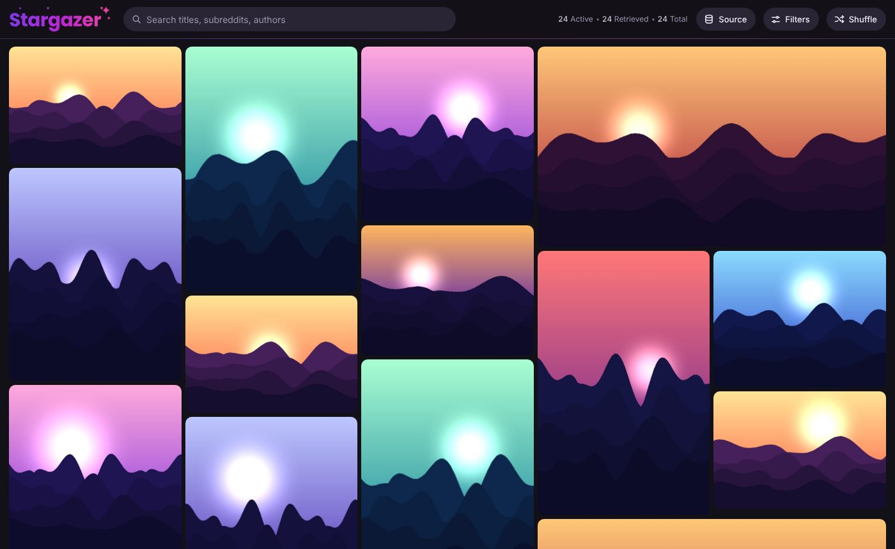
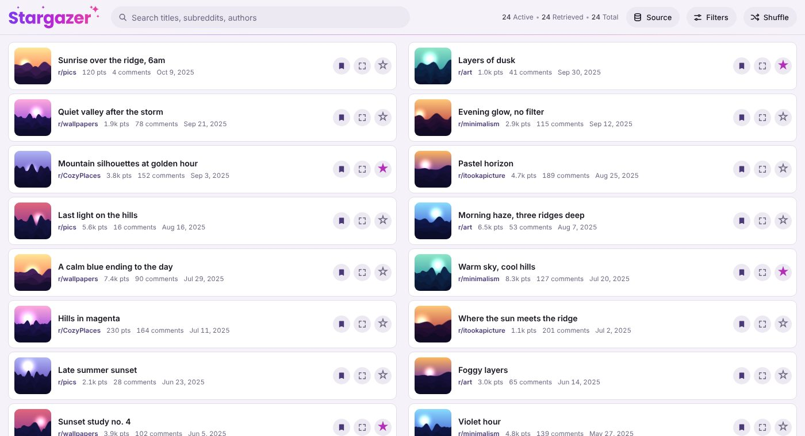
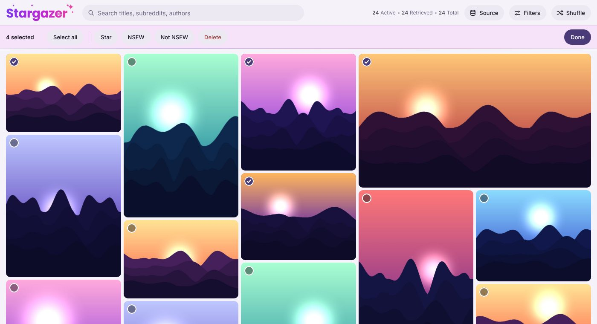
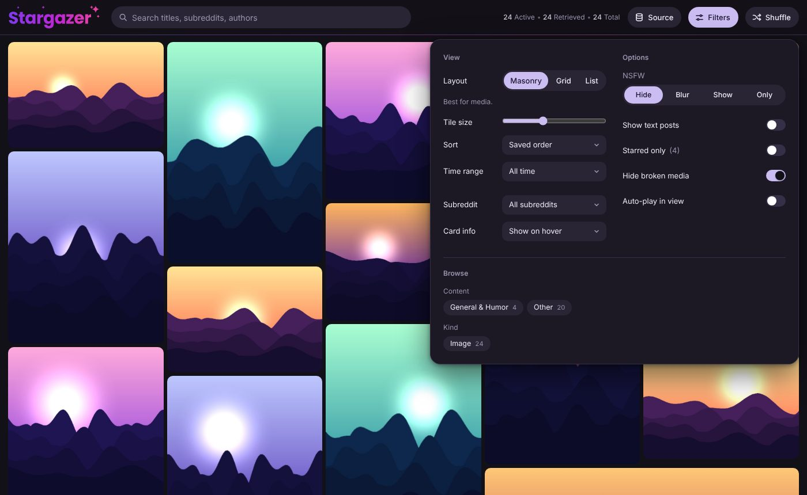
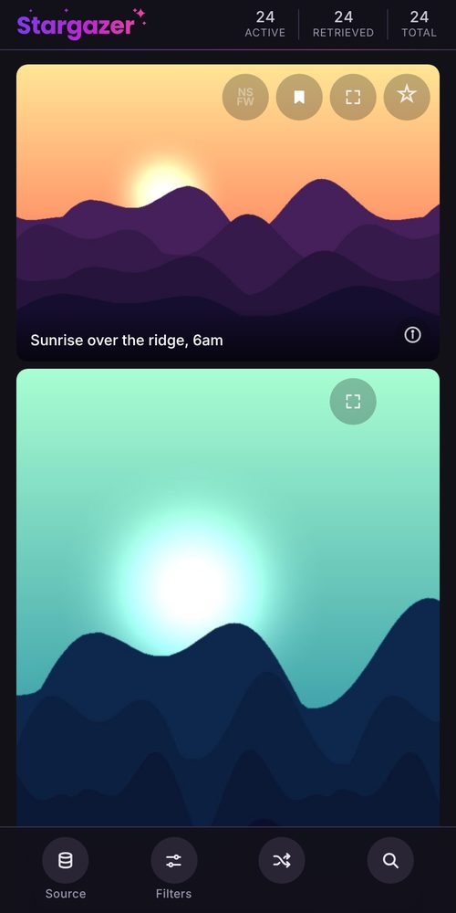

<h1 align="center">Stargazer</h1>

  <b>Browse your saved Reddit posts as a fast, searchable visual gallery.</b> 
  Filter, favourite, clean up and recover your full saved history, including posts Reddit no longer shows you.

  <a href="https://tulosi.github.io/stargazer/"><b>Open Stargazer</b></a> ·
  <a href="https://tulosi.github.io/stargazer/stargazer.zip"><b>Download the standalone page</b></a> ·
  <a href="#quick-start">Quick start</a> ·
  <a href="#faq">FAQ</a>

Free · No sign-up required · One page, no install · Works on desktop and phone

  

Screenshots use invented sample posts and generated artwork, not a real account.

---

## What it is

Reddit only shows the last 1,000 things you have saved (posts and comments together). Your account data export, however, holds a full inventory of everything you have ever saved.

Stargazer turns that export into a visual gallery you can actually comb through. Drop in your CSV and scroll your whole history as images, clips and cards, then filter it, favourite the keepers, unsave the rest, and export the cleaned-up list again whenever you like.

## What you can do

**Browse**
- Three layouts: **Masonry** (best for pictures and clips), **Grid** (equal squares) and **List** (compact rows with a small thumbnail, easiest for scanning text posts). Choose a different layout for each list; List view also lets you pick 1, 2, 3 or Auto columns.
- A built-in viewer for images, galleries, videos, YouTube and RedGifs, with previous/next post navigation (arrow keys, swipe or buttons).
- Search titles, subreddits and authors; sort by hot, newest, oldest, most comments, highest score or subreddit; limit by time range.
- Light and dark themes, adjustable tile size, and a layout that adapts to phones.

**Filter**
- By subreddit, media type (image, GIF, video, gallery, link, text post, removed, recovered) and favourites.
- **NSFW handling you control:** Hide, Blur, Show or Only. The automatic guess can be overridden on any post with one tap.

**Curate**
- Star your favourites.
- Unsave posts with **Undo**, or use **Bulk Actions** to star, mark NSFW or delete many at once.
- **Remove dead posts** in one step: clear out removed or deleted posts and media that no longer loads (you are asked first, and can export a backup).

**Recover**
- Posts that were removed from Reddit are looked up in public archives (Arctic Shift, PullPush and the Wayback Machine), so titles, images and context can be brought back where an archive has them.

**Keep your data portable**
- Everything lives in a plain CSV. **Open**, **Merge** and **Export** it any time. Merging is safe: the newer change wins, and a post you deleted is never brought back by an older copy.

## A look around

<table>
  <tr>
    <td width="50%"> <b>List view</b>: compact rows that are easy to scan, in 1, 2, 3 or Auto columns.</td>
    <td width="50%"> <b>Bulk Actions</b>: select many posts, then star, mark NSFW or delete them at once.</td>
  </tr>
  <tr>
    <td width="50%"> <b>Filters</b>: layout, sort, time range, subreddit, NSFW handling and more.</td>
    <td width="50%" align="center"> <b>On your phone</b>: the same list with a thumb-friendly bottom bar.</td>
  </tr>
</table>

## Quick start

1. **Get your Reddit data.** Request your data at [reddit.com/settings/data-request](https://www.reddit.com/settings/data-request). Reddit prepares it and sends you a download link, which can take a while. Inside is your saved posts CSV.
2. **Open Stargazer** at [tulosi.github.io/stargazer](https://tulosi.github.io/stargazer/) (or the [standalone page](#download-the-standalone-page)).
3. **Open your CSV** with the Source button, or drag it onto the page. Previews start loading as you scroll.

Newer export later? Use **Merge CSV** to fold it into your existing list without losing your stars, deletions or NSFW marks.

## Use it entirely on your own computer

Yes, no account and no server of mine are involved:

- Your list is stored **in your browser** (and, in Chrome, Edge and other Chromium browsers, can be linked to a CSV file on your disk so every change is written straight back to it).
- The page is a single file with no build step, and it has no analytics or tracking. It runs fine opened straight from disk (`file://`).
- Accounts are **optional**. Without one, nothing about your list is ever uploaded to anything I run.

What "local" does and does not mean:

- Thumbnails and clips are fetched by your browser from Reddit and the usual media hosts (`i.redd.it`, `preview.redd.it`, Imgur, RedGifs, YouTube), so you need an internet connection to see previews. The list itself, your filters and your edits work offline.
- Recovering removed posts sends the post's ID to the public archives listed above, and RedGifs clips are looked up on RedGifs. Nothing else about you is sent.
- Fonts are loaded from Google Fonts. Scripts are never loaded from third parties.

## Download the standalone page

Prefer to keep a copy that does not depend on any website? **[Download stargazer.zip](https://tulosi.github.io/stargazer/stargazer.zip)**, unzip it anywhere and double-click `stargazer.html` to open it in your browser. It is the exact same app as the hosted site, with no personal data in it, and it starts empty. With no account settings present, the sign-in section is simply hidden.

The hosted site updates automatically; a downloaded copy is a snapshot, so download it again when you want new features.

## Optional: sync across devices with an account

If you would rather have the same list on your phone and your computer, you can create a free account from the Source panel and your list syncs between devices. Saving, starring and deleting sync automatically, edits made offline upload when you reconnect, and **Sign out** can wipe the list from that browser (handy on shared computers). It is entirely optional; everything above works without it.

Want to run your own copy with your own account system? See the [self-hosting guide](docs/SELF-HOSTING.md).

## FAQ

**Is it free?** Yes. There is no sign-up, no ad and no paid tier.

**Does it change my Reddit account?** No. Stargazer never logs in to Reddit. Unsaving a post removes it from *your Stargazer list* only; your saved posts on Reddit are untouched.

**Why do some previews say "not loaded" or "removed"?** The post was deleted or removed, the media host is down, or a site is rate limiting. Stargazer retries gently and pauses on bursts of failures instead of hammering anyone. Removed posts are looked up in the archives, and where none has a copy it says so.

**Why is Reddit's own "hot" feed not available?** Browsers are not allowed to read it from a web page, so Subreddit mode uses an archive-based approximation. If you want the real thing, [`tools/hot_relay.py`](tools/hot_relay.py) is a small relay you can run on your own computer.

**Which browsers work?** Any current desktop or phone browser should. Linking a CSV file on disk needs a Chromium browser such as Chrome or Edge; elsewhere the list is kept in the browser's own storage and you export a CSV for backups.

**Where is my data?** In your browser's storage on your device (plus your CSV, if you linked one). Clearing site data removes it, so export a CSV now and then.

## For developers

Stargazer is one HTML file ([`site/index.html`](site/index.html)) with no dependencies and no build step. Tests are Playwright scripts in [`tests/`](tests/) that load the page with the network mocked, for example `python tests/layout_test.py`. Project conventions live in [`CLAUDE.md`](CLAUDE.md). Issues and suggestions are welcome.
